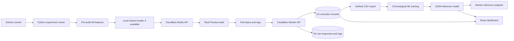

# PipelineGuard

**A lightweight machine-learning approach for predicting CI/CD pipeline failures.**

PipelineGuard extracts Git metadata before a build, optionally scores it with a model trained on prior real Cloudflare Workers Builds, triggers a real Preview build, polls Cloudflare for the authoritative outcome, and stores the resulting observation in D1 (structured record) and R2 (raw API payload/logs).

> **No synthetic training data.** The repository ships with an empty dataset. A row is eligible for training only after a Cloudflare build has completed and its UUID, commit, status, and outcome have been verified. Unit-test mocks are never exported as observations.

## First milestone

1. Create a Cloudflare Worker and connect this GitHub repository using the Cloudflare GitHub App (one-time dashboard authorization).
2. Configure a non-production Preview trigger.
3. Add credentials to Codespaces secrets.
4. Run `python scripts/run_experiment.py --count 1`.
5. Confirm the execution appears in D1 and the dashboard.

The project is designed to be configured and smoke-tested in roughly three hours. The 300-build campaign is a later, resumable data-collection activity, not a three-hour promise.

## Architecture



## Stack

- Cloudflare Workers Builds REST API for real CI execution
- Python 3.11+, requests, GitPython, pandas, NumPy, scikit-learn
- Cloudflare Worker (TypeScript), D1, R2, Wrangler
- React, Vite, TypeScript, Recharts
- GitHub Codespaces

## Cloudflare setup

### 1. Connect GitHub

In the Cloudflare dashboard, open **Workers & Pages → select/create a Worker → Settings → Builds → Connect**. Install/authorize the Cloudflare GitHub App for the repository. This dashboard authorization is required; the project cannot silently grant itself repository access.

Create a Worker for the API/dashboard (for example `pipelineguard-api`) and connect it to this repository. Create and push a dedicated experiment branch before configuring the Preview trigger:

```bash
git switch -c pipelineguard-experiment
# make a meaningful source/test change
git add . && git commit -m 'chore: establish PipelineGuard experiment branch'
git push -u origin pipelineguard-experiment
```

Configure a Preview trigger for that non-production branch. Do not point the experiment at `main` or use a production deployment trigger. To avoid automatic push-triggered builds being duplicated by the runner's explicit API calls, configure the Preview trigger's automatic branch matching so the experiment branch is excluded from automatic builds where your account's trigger configuration permits it. The runner itself always uses the explicit build-trigger endpoint and does not create a second automatic trigger.

### 2. Create credentials

Create a **user-scoped** Cloudflare API token at <https://dash.cloudflare.com/profile/api-tokens>. The current Builds API documentation requires Workers Builds Configuration: Edit; Workers Scripts: Read is needed when looking up a Worker tag. Account-scoped tokens are not accepted by the Builds API. The API token is not the build token UUID.

Find the separate build token UUID in **Worker → Settings → Builds → API token** (or via the documented build-token endpoint). Keep both values secret.

### 3. Required Codespaces secrets / environment

Copy `.env.example` to `.env` for local use, or add these as Codespaces repository secrets:

- `CF_API_TOKEN`: user-scoped API token
- `CF_ACCOUNT_ID`: Cloudflare account ID
- `CF_WORKER_TAG`: immutable Worker script tag, not its display name
- `CF_PREVIEW_TRIGGER_UUID`: UUID of the non-production Preview trigger
- `PIPELINEGUARD_API_URL`: deployed Worker URL, e.g. `https://pipelineguard-api.<subdomain>.workers.dev`
- `PIPELINEGUARD_API_KEY`: shared ingestion key set as a Worker secret

Optional: `CF_BUILD_BRANCH` (defaults to `pipelineguard-experiment`), `BUILD_TIMEOUT_SECONDS` (defaults 1200), `POLL_INTERVAL_SECONDS` (defaults 15), `MAX_EXPERIMENT_BUILDS` (defaults 300).

Never commit `.env`, tokens, or raw logs.

### 4. D1 and R2

From `worker/`:

```bash
npx wrangler d1 create pipelineguard-db
npx wrangler r2 bucket create pipelineguard-raw
```

Put the returned D1 database ID in `worker/wrangler.jsonc`, then:

```bash
npx wrangler d1 migrations apply pipelineguard-db --remote
npx wrangler secret put PIPELINEGUARD_API_KEY
```

The checked-in config uses placeholders intentionally. Bindings are named `DB` and `RAW_BUILDS`.

### 5. Deploy

```bash
cd worker
npm install
npx wrangler deploy
```

Build the dashboard and serve it as Worker static assets using the configured `assets.directory` (`../dashboard/dist`). Set the Cloudflare Builds Preview trigger's **build command** to:

```bash
npm install && npm --prefix dashboard install && npm --prefix worker install && npm test && npm run build
```

Keep the trigger root directory at `/` and set its **deploy command** to `cd worker && npx wrangler deploy`. For a manual deployment from Codespaces, from repository root run:

```bash
npm install && npm --prefix dashboard install && npm --prefix worker install && npm test && npm run build
cd worker && npx wrangler deploy
```

## Codespaces setup

Open the repository in Codespaces. The devcontainer installs Python and Node. Then:

```bash
bash scripts/setup.sh
source .venv/bin/activate
cp .env.example .env
# populate .env; never commit it
```

For local dashboard development: `npm run dev:dashboard`. For local Worker development: `npm run dev:worker` after configuring bindings in Wrangler.

## First real build

Ensure your configured Preview trigger points at this repository and that the configured build command runs the included application checks. Then:

```bash
python scripts/run_experiment.py --count 1
```

The runner requires a clean Git working tree and the current commit to exist on the configured remote branch. It records a prediction of `null` when no trained model is available; it does not invent a probability.

## 300-execution campaign

Start small, inspect the results, then increase gradually:

```bash
python scripts/run_experiment.py --count 5
python scripts/run_experiment.py --count 50 --confirm-large
python scripts/run_experiment.py --count 300 --confirm-large
```

The runner writes `dataset/experiment_progress.json` after each verified completion and resumes by default. `--fresh` starts a new campaign progress file but does not delete historical records. One build runs at a time. Before manually triggering, it checks recent Cloudflare builds for the exact branch/commit and reuses a matching automatic build if found, avoiding the common duplicate-trigger case. Use Ctrl+C to stop the runner safely.

**Controlled failures:** this starter intentionally does not auto-edit or commit broken source code. To collect a genuine failure, create a dedicated experiment branch and commit a real failing test/build change, then run the campaign against that branch. Scenario labels are metadata only and are excluded from model features. Do not repeatedly rebuild an identical commit and claim meaningful feature diversity.

## Data and labels

- Prediction-time features are computed before the API trigger call from Git diff/history and earlier completed observations.
- Labels (`actual_build_status`, `actual_build_outcome`, duration, logs) are only attached after Cloudflare reports a terminal state.
- API errors, timeouts, cancelled builds, and incomplete builds are not pipeline-failure labels.
- D1 stores structured records; each build's raw response/logs are stored separately in R2.
- CSV export includes only completed, verified builds with a valid binary outcome.

Run:

```bash
python scripts/export_dataset.py
python scripts/validate_dataset.py
python scripts/train_model.py
python scripts/upload_model.py  # publish model.json + evaluation.json to R2 for Worker inference
```

Training uses chronological splits. It refuses to claim useful evaluation when the dataset is too small or lacks both classes. The exported `model.json` is a compact Random Forest representation for Worker-side inference; full scikit-learn is not loaded into the Worker.

## Dashboard

The dashboard reads live records and metrics from the Worker API. Empty states are expected until real builds have been collected. It does not ship with sample statistics.

## API

- `GET /api/health` health and model state
- `GET /api/summary` live counts and failure rate
- `GET /api/builds` paginated execution history
- `GET /api/model` model evaluation and feature importance
- `POST /api/predictions` authenticated pre-build prediction record
- `POST /api/ingest` authenticated build record ingestion from runner
- `POST /api/predict` authenticated pre-build inference request

## Tests

```bash
python -m pytest
npm test
cd worker && npm test
```

Tests use mocks for isolated parsing/validation only. Mock records are never persisted or exported as training data.

## Cost, quotas, and safety

Cloudflare's current documentation should be checked before each campaign. The published Free-plan allowance currently lists 3,000 build minutes/month, one concurrent build, a 20-minute build timeout, and 90-day build/log retention. This project defaults to serial execution and a 20-minute timeout. It does not upgrade plans automatically.

Actual build-minute use is the sum of measured Cloudflare build durations, not the requested count. At a measured average of `d` minutes, 300 builds consume approximately `300 × d` build minutes. Check account usage before scaling; stop if remaining quota is insufficient. Builds may incur other account usage depending on configuration.

To stop: Ctrl+C the runner. To remove resources, delete the Worker, D1 database, R2 bucket, and Builds triggers in the Cloudflare dashboard/API after exporting anything you need. Do not delete raw data until retention requirements are understood.

## Limitations

- Cloudflare GitHub App authorization and initial resource creation require user action in the dashboard/CLI.
- The experiment runner requires the configured Preview trigger to exist; it does not claim to configure GitHub permissions automatically.
- Cloudflare API schemas can evolve. The integration validates required fields and fails closed on unexpected responses.
- A useful model requires sufficient real, diverse, temporally ordered executions and both outcome classes. 300 is a collection target, not a statistical guarantee.
- The first version uses commit-level grouping to reduce leakage; very closely related commits may still require stricter grouping for rigorous research.
