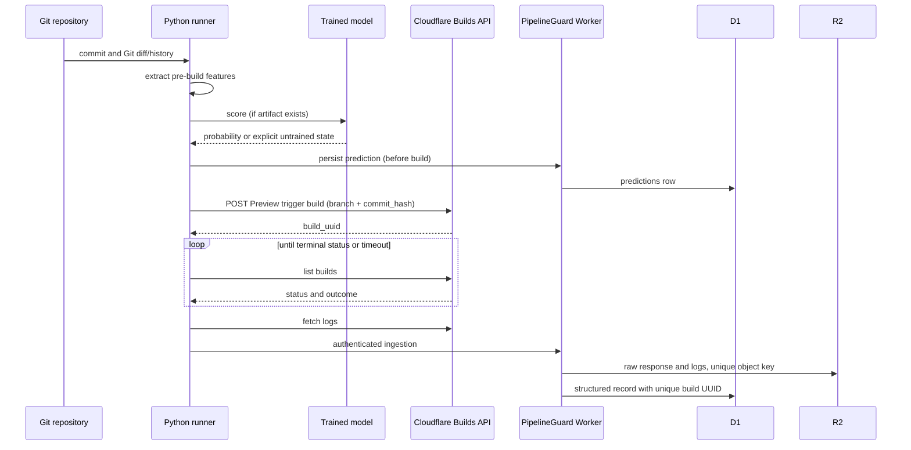

# Architecture

The Python runner is the explicit orchestrator. Cloudflare Workers Builds does not provide a pre-build ML prediction hook in this design. The runner computes features, requests inference, records the prediction, then calls the Preview trigger endpoint.

## Boundaries

- Cloudflare API token: user-scoped, used by Python runner only.
- Build token UUID: separate deployment credential configured on the Cloudflare trigger.
- Worker ingestion key: separate shared secret; never reuse the Cloudflare API token.
- D1: queryable metadata and labels.
- R2: raw build response/log payload and trained model JSON.
- Dashboard: read-only data presentation; experiment execution is controlled from Codespaces CLI.
